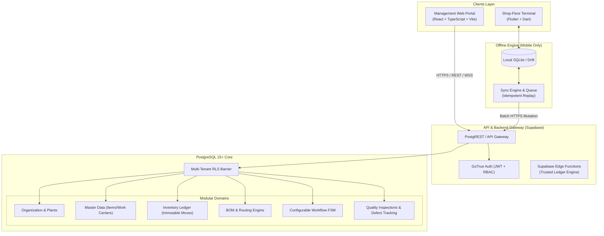
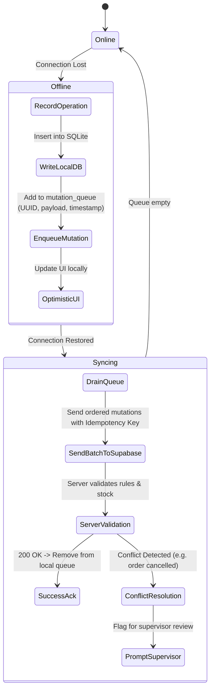

# MFGOS: System Architecture & Design Specification

## 1. Architectural Philosophy: The Modular Monolith
To deliver a high-integrity, production-grade manufacturing execution system within the academic timeframe, MFGOS adopts a **Modular Monolith** architecture rather than a distributed microservices network. 

### Why Modular Monolith for MFGOS?
- **Transactional Consistency:** Manufacturing relies heavily on ACID guarantees. When raw materials are consumed and work-in-progress is credited, cross-table relational constraints and atomic transactions eliminate the distributed split-brain failure modes common in microservices.
- **Lower Operational Overhead:** Simplifies deployment, debugging, and local evaluation for university project defense.
- **Clear Module Boundaries:** Domain boundaries (Auth, Master Data, Inventory, Workflows, Quality) are strictly separated by directories and interfaces, allowing easy microservice extraction if future enterprise scaling demands it.



---

## 2. Multi-Tenant Data Isolation Strategy
MFGOS implements strict tenant isolation using PostgreSQL **Row-Level Security (RLS)**.

### Tenant Hierarchy:
```
Organization (e.g., Apex Precision Machining Ltd.)
  └── Plant 1 (North Machining Facility)
       ├── Warehouse 1 (Raw Material Yard)
       ├── Warehouse 2 (Finished Goods Store)
       └── Work Centers (CNC Lathes, Mills, Assembly Benches)
  └── Plant 2 (South Fabrication Unit)
```

### RLS Enforcement Mechanism:
Every business table contains `organization_id UUID NOT NULL REFERENCES organizations(id)`.
1. The authenticated user's JWT contains their `user_id` (`auth.uid()`).
2. An SQL security helper function `current_user_org_ids()` resolves which organizations the user belongs to:
   ```sql
   CREATE FUNCTION current_user_org_ids() 
   RETURNS SETOF UUID AS $$
     SELECT organization_id FROM organization_members 
     WHERE user_id = auth.uid() AND is_active = TRUE;
   $$ LANGUAGE sql SECURITY DEFINER STABLE;
   ```
3. Tables enforce tenant boundaries via declarative policies:
   ```sql
   CREATE POLICY tenant_isolation_policy ON products
     FOR ALL
     USING (organization_id IN (SELECT current_user_org_ids()));
   ```

---

## 3. The Configurable Workflow Engine Architecture
The key technical innovation of MFGOS is separating the manufacturing process from application code.

### Metadata-Driven Finite State Machine (FSM):
Instead of hardcoding states like `DRAFT -> CUTTING -> WELDING -> QC -> COMPLETED`, the system models production orders through three relational entities:

```
[workflows] ──< [workflow_stages] ──< [workflow_transitions]
     │
     └──< [production_orders] ──< [workflow_history]
```

1. **`workflows`:** Named process templates (e.g., *"Heavy CNC Shaft Turning"*, *"Standard Wooden Chair Assembly"*).
2. **`workflow_stages`:** Ordered sequence of states, each configured with:
   - `stage_code` (e.g., `MACHINING_01`)
   - `stage_name` (e.g., `Primary Turning & Boring`)
   - `required_role` (e.g., `Production Operator`)
   - `requires_quality_signoff` (Boolean flag)
   - `sequence_order` (Integer)
3. **`workflow_transitions`:** Directed graph specifying permitted origin-destination transitions:
   - Example: `STAGE_CUTTING -> STAGE_ASSEMBLY` (Allowed)
   - Example: `STAGE_CUTTING -> STAGE_COMPLETED` (Disallowed - cannot bypass stages)
4. **`workflow_history`:** Immutable audit log capturing every state shift, operator identity, timestamp, good quantity, and rejected quantity.

---

## 4. Double-Entry Stock Movement Ledger Architecture
To eliminate phantom inventory and data discrepancies, MFGOS uses an immutable stock movement model.

### Invariant Rules:
1. **No Destructive Overwrite:** A product's quantity in a warehouse is the mathematical sum of its historic stock movements:
   $$\text{Current Stock} = \sum \text{Stock In} - \sum \text{Stock Out}$$
2. **Atomic Movement Recording:** Every receipt, issue, transfer, or scrap adjustment executes inside a PostgreSQL transaction that inserts into `stock_movements` and atomically validates the destination/source balances.
3. **Non-Negative Invariant:** A PostgreSQL trigger checks `new_balance >= 0` before committing any withdrawal. If a race condition attempts to consume stock below zero, the transaction rolls back with code `ERR_INSUFFICIENT_STOCK`.

---

## 5. Offline-First Mobile Synchronization Architecture
Shop floor operators work in environments with unreliable connectivity. The Flutter mobile app uses an offline-first architecture powered by **Drift (SQLite)** and a custom **Sync Manager**.



### Concurrency & Conflict Strategy:
- **Idempotency Keys:** Every mobile mutation generates a client-side UUID v4 `idempotency_key`. If a network timeout occurs and the client retries, the server recognizes the key and returns the cached result without duplicate execution.
- **Last-Write-Wins with Stage Locks:** When an operator begins an assigned stage, a temporary lock is recorded on the order. If two operators attempt concurrent updates on the same stage, the first committed timestamp wins, and the second is notified of the completed state.
