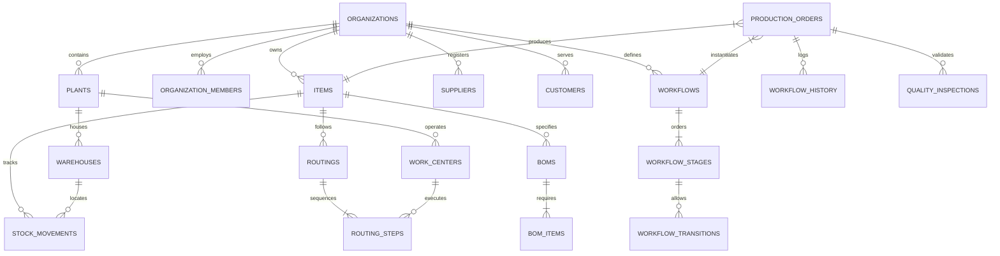

# MFGOS: Database Architecture & Relational Schema Design

## 1. Relational Entity Overview
The MFGOS database is designed around strict multi-tenancy, immutable operational logging, and atomic transaction integrity.

---

## 2. Table Specifications

### 2.1 Identity, Multi-Tenancy & Access Control

#### `organizations`
| Column | Type | Constraints | Description |
| :--- | :--- | :--- | :--- |
| `id` | UUID | PK, DEFAULT gen_random_uuid() | Unique organization identifier |
| `name` | VARCHAR(255) | NOT NULL | Registered manufacturing entity name |
| `code` | VARCHAR(50) | NOT NULL, UNIQUE | Company ticker / short code (e.g. APEX) |
| `industry_type`| VARCHAR(100) | NOT NULL | e.g. Precision Engineering, Furniture, Textile |
| `created_at` | TIMESTAMPTZ | DEFAULT now() | Creation timestamp |

#### `plants`
| Column | Type | Constraints | Description |
| :--- | :--- | :--- | :--- |
| `id` | UUID | PK, DEFAULT gen_random_uuid() | Unique plant identifier |
| `organization_id` | UUID | FK -> organizations(id), CASCADE | Tenant reference |
| `name` | VARCHAR(255) | NOT NULL | Facility name (e.g., Plant 1 - Machine Shop) |
| `code` | VARCHAR(50) | NOT NULL | Plant code (e.g., PLT-01) |
| `location` | TEXT | | Physical address |

#### `profiles`
| Column | Type | Constraints | Description |
| :--- | :--- | :--- | :--- |
| `id` | UUID | PK, FK -> auth.users(id) | Supabase auth user reference |
| `email` | VARCHAR(255) | NOT NULL, UNIQUE | User email address |
| `full_name` | VARCHAR(255) | NOT NULL | Display name |
| `avatar_url`| TEXT | | Profile image link |

#### `organization_members`
| Column | Type | Constraints | Description |
| :--- | :--- | :--- | :--- |
| `id` | UUID | PK, DEFAULT gen_random_uuid() | Membership record ID |
| `organization_id` | UUID | FK -> organizations(id) | Organization reference |
| `user_id` | UUID | FK -> profiles(id) | User reference |
| `role` | VARCHAR(50) | NOT NULL | SUPER_ADMIN, PROD_MGR, WHS_MGR, OPERATOR, QC_INSP |
| `is_active` | BOOLEAN | DEFAULT TRUE | Active status |

---

### 2.2 Master Data Management

#### `units_of_measure`
| Column | Type | Constraints | Description |
| :--- | :--- | :--- | :--- |
| `id` | UUID | PK, DEFAULT gen_random_uuid() | UOM identifier |
| `organization_id` | UUID | FK -> organizations(id) | Tenant reference |
| `name` | VARCHAR(50) | NOT NULL | e.g., Kilogram, Meter, Piece |
| `symbol` | VARCHAR(10) | NOT NULL | e.g., kg, m, pcs |
| `category` | VARCHAR(50) | NOT NULL | Weight, Length, Count, Volume |

#### `items` (Products & Raw Materials)
| Column | Type | Constraints | Description |
| :--- | :--- | :--- | :--- |
| `id` | UUID | PK, DEFAULT gen_random_uuid() | Item identifier |
| `organization_id` | UUID | FK -> organizations(id) | Tenant reference |
| `sku` | VARCHAR(100) | NOT NULL | Stock Keeping Unit code |
| `name` | VARCHAR(255) | NOT NULL | Item name |
| `type` | VARCHAR(50) | NOT NULL | `RAW_MATERIAL`, `FINISHED_GOOD`, `WIP_ASSEMBLY` |
| `uom_id` | UUID | FK -> units_of_measure(id) | Base unit of measure |
| `category` | VARCHAR(100) | | Functional category |
| `safety_stock` | DECIMAL(12,4)| DEFAULT 0.0 | Low stock alert threshold |
| `standard_cost`| DECIMAL(12,2)| DEFAULT 0.0 | Standard unit cost |

#### `warehouses`
| Column | Type | Constraints | Description |
| :--- | :--- | :--- | :--- |
| `id` | UUID | PK, DEFAULT gen_random_uuid() | Warehouse identifier |
| `organization_id` | UUID | FK -> organizations(id) | Tenant reference |
| `plant_id` | UUID | FK -> plants(id) | Physical facility reference |
| `name` | VARCHAR(255) | NOT NULL | Warehouse name (e.g. Steel Yard) |
| `code` | VARCHAR(50) | NOT NULL | Code (e.g. WH-RAW-01) |

#### `work_centers`
| Column | Type | Constraints | Description |
| :--- | :--- | :--- | :--- |
| `id` | UUID | PK, DEFAULT gen_random_uuid() | Work center identifier |
| `organization_id` | UUID | FK -> organizations(id) | Tenant reference |
| `plant_id` | UUID | FK -> plants(id) | Plant location |
| `name` | VARCHAR(255) | NOT NULL | Work center name (e.g., CNC Milling Center 1) |
| `code` | VARCHAR(50) | NOT NULL | e.g. WC-CNC-01 |
| `hourly_rate` | DECIMAL(10,2)| DEFAULT 0.0 | Operational cost per hour |
| `capacity_hours`| DECIMAL(6,2)| DEFAULT 8.0 | Standard daily operating hours |

---

### 2.3 Inventory & Stock Movements (Immutable Ledger)

#### `stock_movements`
| Column | Type | Constraints | Description |
| :--- | :--- | :--- | :--- |
| `id` | UUID | PK, DEFAULT gen_random_uuid() | Movement event ID |
| `organization_id` | UUID | FK -> organizations(id) | Tenant reference |
| `item_id` | UUID | FK -> items(id) | Item affected |
| `warehouse_id` | UUID | FK -> warehouses(id) | Target or source warehouse |
| `movement_type` | VARCHAR(50) | NOT NULL | `RECEIPT`, `ISSUE`, `TRANSFER`, `ADJUSTMENT`, `RETURN` |
| `quantity` | DECIMAL(12,4)| NOT NULL | Signed quantity (+ positive, - negative) |
| `reference_type`| VARCHAR(50) | | e.g. `PURCHASE_ORDER`, `PROD_ORDER`, `MANUAL_ADJ` |
| `reference_id` | VARCHAR(100) | | Linked document or transaction ID |
| `remarks` | TEXT | | Reason for adjustment |
| `created_by` | UUID | FK -> profiles(id) | User who recorded movement |
| `created_at` | TIMESTAMPTZ | DEFAULT now() | Movement recording timestamp |

---

### 2.4 Configurable Workflow Engine

#### `workflows`
| Column | Type | Constraints | Description |
| :--- | :--- | :--- | :--- |
| `id` | UUID | PK, DEFAULT gen_random_uuid() | Workflow template ID |
| `organization_id` | UUID | FK -> organizations(id) | Tenant reference |
| `name` | VARCHAR(255) | NOT NULL | Workflow name (e.g. Precision Gear Route) |
| `description` | TEXT | | Purpose / Industry summary |
| `is_active` | BOOLEAN | DEFAULT TRUE | Available for production |

#### `workflow_stages`
| Column | Type | Constraints | Description |
| :--- | :--- | :--- | :--- |
| `id` | UUID | PK, DEFAULT gen_random_uuid() | Stage identifier |
| `workflow_id` | UUID | FK -> workflows(id), CASCADE | Workflow parent |
| `stage_code` | VARCHAR(50) | NOT NULL | Unique code (e.g. STAGE_CUTTING) |
| `stage_name` | VARCHAR(255) | NOT NULL | Display title |
| `sequence_order`| INT | NOT NULL | Order index |
| `required_role` | VARCHAR(50) | | Role permitted to complete stage |
| `requires_qc` | BOOLEAN | DEFAULT FALSE | Requires quality signoff |

#### `workflow_transitions`
| Column | Type | Constraints | Description |
| :--- | :--- | :--- | :--- |
| `id` | UUID | PK, DEFAULT gen_random_uuid() | Transition rule ID |
| `workflow_id` | UUID | FK -> workflows(id), CASCADE | Workflow reference |
| `from_stage_id` | UUID | FK -> workflow_stages(id) | Origin stage |
| `to_stage_id` | UUID | FK -> workflow_stages(id) | Permitted next stage |
| `is_terminal` | BOOLEAN | DEFAULT FALSE | Marks completion of production |

---

### 2.5 Production Execution & Quality

#### `production_orders`
| Column | Type | Constraints | Description |
| :--- | :--- | :--- | :--- |
| `id` | UUID | PK, DEFAULT gen_random_uuid() | Production order ID |
| `organization_id` | UUID | FK -> organizations(id) | Tenant reference |
| `order_number` | VARCHAR(100) | NOT NULL, UNIQUE | e.g. PO-2026-001 |
| `item_id` | UUID | FK -> items(id) | Product to manufacture |
| `workflow_id` | UUID | FK -> workflows(id) | Configured production workflow |
| `current_stage_id`| UUID | FK -> workflow_stages(id) | Active process stage |
| `planned_quantity`| DECIMAL(12,4)| NOT NULL | Quantity ordered |
| `completed_quantity`| DECIMAL(12,4)| DEFAULT 0.0 | Accepted quantity produced |
| `rejected_quantity`| DECIMAL(12,4)| DEFAULT 0.0 | Defective scrapped quantity |
| `status` | VARCHAR(50) | NOT NULL | `PLANNED`, `IN_PROGRESS`, `ON_HOLD`, `COMPLETED` |
| `start_date` | TIMESTAMPTZ | | Scheduled / actual start |
| `due_date` | TIMESTAMPTZ | | Promised delivery date |

#### `workflow_history`
| Column | Type | Constraints | Description |
| :--- | :--- | :--- | :--- |
| `id` | UUID | PK, DEFAULT gen_random_uuid() | History event ID |
| `production_order_id`| UUID | FK -> production_orders(id) | Production order reference |
| `from_stage_id` | UUID | FK -> workflow_stages(id) | Origin stage |
| `to_stage_id` | UUID | FK -> workflow_stages(id) | New stage |
| `quantity_passed`| DECIMAL(12,4)| DEFAULT 0.0 | Good count passing to next step |
| `quantity_rejected`| DECIMAL(12,4)| DEFAULT 0.0 | Scrap count at this step |
| `operator_id` | UUID | FK -> profiles(id) | Operator who submitted step |
| `cycle_time_minutes`| INT | | Duration spent executing step |
| `notes` | TEXT | | Shop floor observations |
| `created_at` | TIMESTAMPTZ | DEFAULT now() | Transition timestamp |
