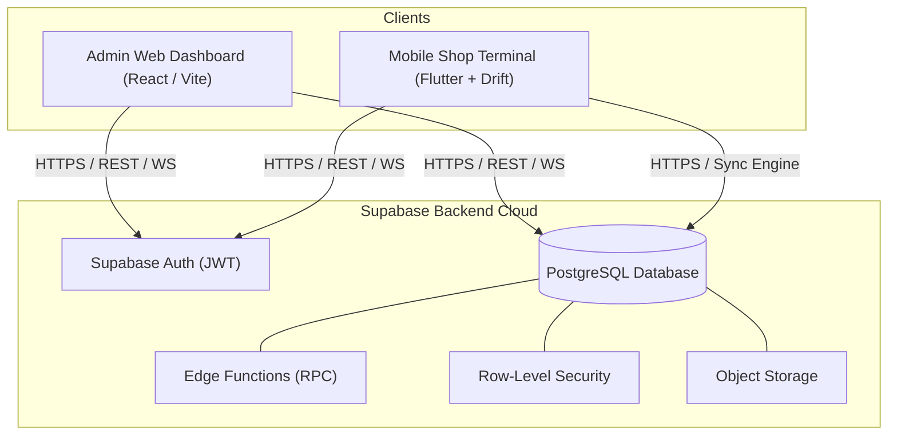
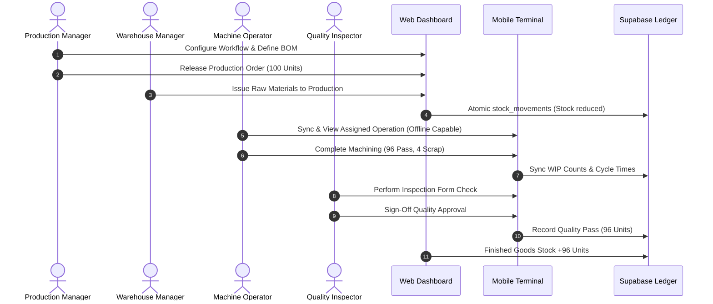

# Software Requirements Specification (SRS)
## For MFGOS: Configurable Manufacturing Operations System
**Document Version:** 1.0.0  
**Project Type:** Final-Year B.Tech Computer Engineering Major Project  
**Standard:** IEEE Std 830-1998 Compliant  

---

## 1. Introduction

### 1.1 Purpose
This Software Requirements Specification (SRS) details the functional and non-functional specifications for **MFGOS (Configurable Manufacturing Operations System)**. It establishes the technical contract between stakeholders, academic evaluators, and the development team for system implementation, validation, and evaluation.

### 1.2 Scope of the System
MFGOS is a multi-tenant, cloud-backed manufacturing execution and management system designed to eliminate software rigidity across diverse discrete manufacturing sectors (e.g., precision engineering, furniture, textiles). The platform integrates:
- Multi-tenant organization and plant isolation.
- Master data management for products, materials, work centers, and operations.
- Transaction-auditable inventory ledger with non-negative stock invariants.
- Multi-level Bills of Materials (BOM) and production routings.
- Shop-floor production orders and work-in-progress (WIP) tracking.
- **Configurable Workflow Engine**: A database-driven finite state machine permitting dynamic stage sequence definitions and role assignments without code alterations.
- Configurable quality inspections and gating checkpoints.
- A cross-platform Flutter mobile terminal with local SQLite/Drift offline caching and sync.
- Executive analytics and grounded AI-assisted operational insights.

### 1.3 Definitions, Acronyms, and Abbreviations
- **BOM:** Bill of Materials (hierarchical recipe of raw materials and sub-assemblies).
- **ERP:** Enterprise Resource Planning.
- **MES:** Manufacturing Execution System.
- **WIP:** Work In Progress (material in active stages of production).
- **UOM:** Unit of Measure (standardized measurement units e.g., kg, pieces, meters).
- **RLS:** Row-Level Security (PostgreSQL security policy isolating tenant rows).
- **FSM:** Finite State Machine (computational model governing workflow state transitions).
- **Idempotency:** Property of operations that can be applied multiple times without altering results beyond the initial application.

---

## 2. Overall Description

### 2.1 Product Perspective & Context
MFGOS is architected as a modular monolith comprising:
1. **Administrative & Management Web Portal (React + TypeScript + Vite):** Hosted on cloud edge (Vercel) for office-based managers and administrators.
2. **Shop Floor Mobile Terminal (Flutter + Dart):** Running on Android/iOS tablets and mobile devices with local SQLite/Drift persistence for operators.
3. **Backend-as-a-Service Core (Supabase + PostgreSQL):** Managing Auth, Relational Schema, RLS, Storage, and Edge Functions.

### 2.2 User Classes and Roles Matrix

| Role | Interface | Primary Responsibilities |
| :--- | :--- | :--- |
| **Super Admin** | Web | Organization provisioning, plant creation, role & user permissions, audit monitoring. |
| **Production Manager** | Web | BOM creation, routing design, workflow configuration, production order release. |
| **Warehouse Manager** | Web / Mobile | Supplier receipts, stock adjustments, bin transfers, material issuing to jobs. |
| **Production Operator**| Mobile / Web | Viewing assigned tasks, starting/completing operations, logging scrap counts. |
| **Quality Inspector**  | Mobile / Web | Executing inspection templates, approving/rejecting WIP batches, logging defects. |
| **Purchase Manager**   | Web | Supplier administration, purchase orders, receiving coordination. |
| **Sales Manager**      | Web | Customer records, sales orders, finished goods allocation and dispatch. |

### 2.3 Operating Environment
- **Web App:** Modern Chromium/WebKit browsers (Chrome 110+, Edge 110+, Safari 16+, Firefox 110+).
- **Mobile App:** Android 9.0+ (API Level 28+) and iOS 14.0+.
- **Database:** PostgreSQL 15+ hosted on Supabase with PostgREST.

---

## 3. Specific Functional Requirements

### 3.1 Module 1: Authentication & Organization Management
- **FR-AUTH-01:** System shall authenticate users via email/password using Supabase JWT tokens.
- **FR-AUTH-02:** All operational queries shall enforce the `organization_id` context via PostgreSQL Row-Level Security (RLS).
- **FR-AUTH-03:** Users assigned to multiple plants shall be capable of switching active plant context via the header navigation.
- **FR-AUTH-04:** Every critical mutation (workflow edit, stock adjustment, role reassignment) shall write to the `audit_logs` table.

### 3.2 Module 2: Master Data Management (MDM)
- **FR-MDM-01:** System shall maintain finished goods and raw materials with unique SKUs, UOM, and category.
- **FR-MDM-02:** System shall support conversion factors between base units (e.g., 1 box = 24 pieces).
- **FR-MDM-03:** System shall register multiple warehouse locations, dividing them into identifiable zones or bins.
- **FR-MDM-04:** System shall define work centers (machines/assembly stations) with capacity and hourly labor rates.
- **FR-MDM-05:** System shall store standard production operations (e.g., Lathe Turning, MIG Welding, Polishing).

### 3.3 Module 3: Inventory Management & Stock Movement Ledger
- **FR-INV-01 (Auditable Ledger):** Every stock level change MUST generate an immutable record in `stock_movements`. Direct overwrite of total quantities without a movement record is prohibited.
- **FR-INV-02 (Movement Types):** Supported movements: `RECEIPT` (from purchase), `ISSUE` (to production), `TRANSFER` (between warehouses), `ADJUSTMENT` (cycle counts), `RETURN` (rejected materials).
- **FR-INV-03 (Non-Negative Invariant):** Database transactions shall abort with an exception if any operation attempts to drive stock below zero.
- **FR-INV-04 (Low Stock Alerts):** Visual indicators and alerts shall trigger when current quantity falls below `reorder_threshold`.

### 3.4 Module 4 & 5: Configurable Workflow & Manufacturing Engine
- **FR-ENG-01:** Workflows shall be defined as database entities composed of ordered `workflow_stages`.
- **FR-ENG-02:** Each stage shall specify:
  - Stage Name & Code.
  - Allowed Target Roles for execution.
  - Mandatory Quality Check Flag.
  - Permitted Next Stages.
- **FR-ENG-03 (Workflow Flexibility):** Production orders shall bind to a workflow template at release time. Modifying stage definitions shall NOT require recompiling or redeploying code.
- **FR-ENG-04 (Traceability):** Transitioning an order across stages shall log execution timestamp, operator user ID, input/output quantities, and cycle time to `workflow_history`.

### 3.5 Module 8: Quality Assurance & Inspections
- **FR-QC-01:** Quality inspection templates shall define dynamic inspection parameters (e.g., Bore Diameter: 25.0 ± 0.05 mm, Visual Finish: No Scratches).
- **FR-QC-02:** An order stage marked with `requires_qc = TRUE` cannot transition to `COMPLETED` until an authorized Quality Inspector records an approved inspection.
- **FR-QC-03:** Defective quantities shall be partitioned into `reworkable` or `scrap` and immediately excluded from finished goods stock.

### 3.6 Module 10: Mobile Terminal & Offline Synchronization
- **FR-MOB-01:** Mobile app shall persist assigned production orders in local SQLite via Drift.
- **FR-MOB-02:** Operators shall be capable of starting operations, logging completed quantities, and logging defects without an active internet connection.
- **FR-MOB-03:** Offline operations shall be queued locally with UUID v4 idempotency tokens.
- **FR-MOB-04:** Upon network restoration, the background sync manager shall push queued operations to Supabase and handle race conditions via timestamp-based conflict policies.

---

## 4. Non-Functional Requirements

### 4.1 Performance & Scalability
- **NFR-PERF-01:** Web dashboard initial page load time shall be < 1.5 seconds on standard broadband.
- **NFR-PERF-02:** Stock ledger calculation queries shall execute in < 100ms for up to 100,000 movements via indexed foreign keys.
- **NFR-PERF-03:** Mobile sync payload processing shall process up to 50 queued mutations in < 2.0 seconds upon reconnection.

### 4.2 Security & Data Isolation
- **NFR-SEC-01:** Multi-tenancy shall be enforced at the database layer using PostgreSQL RLS policies evaluating `auth.uid()` against `organization_members`.
- **NFR-SEC-02:** All client communications shall use TLS 1.3 encryption.
- **NFR-SEC-03:** Secrets, service role keys, and database passwords shall remain strictly server-side and never be packaged into web or mobile client builds.

### 4.3 Reliability & Availability
- **NFR-REL-01:** Offline operations shall guarantee zero data loss on mobile devices during unexpected app termination.
- **NFR-REL-02:** Stock ledger updates shall execute inside atomic PostgreSQL transactions (`BEGIN ... COMMIT`) to prevent partial state updates.

---

## 5. Use Case Specifications & System Flow

