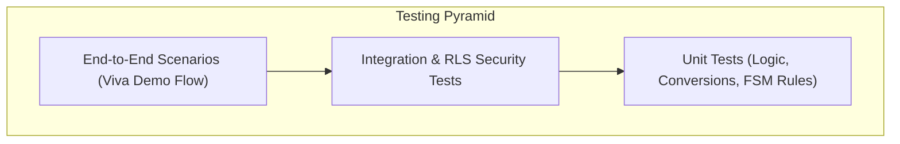

# MFGOS: Comprehensive Testing & Quality Assurance Strategy

## 1. Testing Philosophy & Test Pyramid
MFGOS implements a rigorous multi-tier testing strategy to ensure that business-critical manufacturing operations—specifically inventory movements, multi-tenant isolation, and offline synchronization—remain robust against edge cases, network drops, and race conditions.

---

## 2. Test Verification Matrix

### 2.1 Inventory Consistency & Transactional Invariants
| Test ID | Test Scenario | Expected Outcome | Verification Method |
| :--- | :--- | :--- | :--- |
| **TC-INV-01** | Record positive stock receipt from supplier (+500 kg Steel) | Stock movement recorded; current inventory increments by exactly 500.0 kg | SQL Ledger Sum vs. Current Balance equality |
| **TC-INV-02** | Issue material to production order within available balance (-150 kg Steel) | Stock movement recorded; balance drops to 350.0 kg atomically | Check `stock_movements` table row creation |
| **TC-INV-03** | Attempt negative inventory issue (-600 kg when balance is 350 kg) | Transaction aborted with `ERR_INSUFFICIENT_STOCK`; zero balance changes | PostgreSQL trigger exception validation |
| **TC-INV-04** | Inter-warehouse transfer (WH-Raw to WH-Line) | Dual movements created (+/-) within a single atomic transaction | Verify both source and destination balances |

### 2.2 Configurable Workflow Engine
| Test ID | Test Scenario | Expected Outcome | Verification Method |
| :--- | :--- | :--- | :--- |
| **TC-WKF-01** | Create 5-stage workflow for Precision Machining | Stages saved in order; transitions validated as valid directed acyclic graph | Workflow builder UI and API validation |
| **TC-WKF-02** | Attempt illegal stage jump (e.g. Cutting -> Completed without QC) | Rejected with `ERR_INVALID_TRANSITION` | Transition validator check |
| **TC-WKF-03** | Operator completes stage with 96 good units and 4 defects | `workflow_history` records 96 pass, 4 scrap; WIP counter moves to next stage | Historical log inspection |
| **TC-WKF-04** | Deploy completely different workflow (Furniture 4-stage) | Engine runs furniture flow seamlessly with zero code modifications | Live execution verification |

### 2.3 Multi-Tenant Row-Level Security (RLS)
| Test ID | Test Scenario | Expected Outcome | Verification Method |
| :--- | :--- | :--- | :--- |
| **TC-SEC-01** | User from Org A queries `items` table | Only items matching Org A's ID returned; Org B items completely masked | PostgreSQL RLS policy test |
| **TC-SEC-02** | User attempts direct SQL update on another tenant's stock movement | Query returns 0 rows updated (silent denial) | Penetration testing script |
| **TC-SEC-03** | Role check: Operator attempts to delete production order | HTTP 403 Forbidden / RLS permission denial | Role permission test |

### 2.4 Mobile Offline Synchronization
| Test ID | Test Scenario | Expected Outcome | Verification Method |
| :--- | :--- | :--- | :--- |
| **TC-MOB-01** | Operator switches device to Airplane Mode; completes assigned operation | Mutation stored in local SQLite / Drift; UI optimistically updates step | Local Drift database inspect |
| **TC-MOB-02** | Re-enable connectivity | Background sync manager drains queue; Supabase receives payload; state marked synced | Network restoration simulation |
| **TC-MOB-03** | Replay duplicate sync packet (same UUID v4 idempotency token) | Server recognizes existing idempotency token; returns 200 OK without double-logging | Idempotency verification |

---

## 3. Academic Viva Demonstration Script (Step-by-Step)
1. **Login & Role Showcase:** Log in as Super Admin; display organization and multi-plant switcher.
2. **Master Data Verification:** Demonstrate Industrial Gear item, raw materials (Steel, Bearings, Bolts), and Work Centers (CNC Lathe 1, Milling 2).
3. **Inventory Receipt:** Receive 500 kg Alloy Steel into Raw Materials Warehouse; observe real-time ledger update and KPI dashboard badge.
4. **Workflow Configuration:** Show the Configurable Workflow Builder displaying:
   `Material Prep -> CNC Machining -> Gear Hobbing -> Quality Inspection -> Finished Stock`.
5. **Production Order Release:** Release Order `#PO-2026-001` for 100 Industrial Gears.
6. **Material Issue:** Issue 200 kg Steel, 200 Bearings, 800 Bolts; verify inventory reduction.
7. **Shop-Floor Execution:** Progress through CNC Machining; enter 96 Accepted, 4 Scrapped.
8. **Quality Inspection Gate:** Quality Inspector signs off on 96 accepted units with tolerance measurements.
9. **Finished Stock Allocation:** Verify Finished Goods inventory reflects +96 Industrial Gears.
10. **Configurability Proof:** Switch to a 3-stage Wooden Table Assembly workflow and demonstrate that the same core engine executes it without modifying a line of code!
